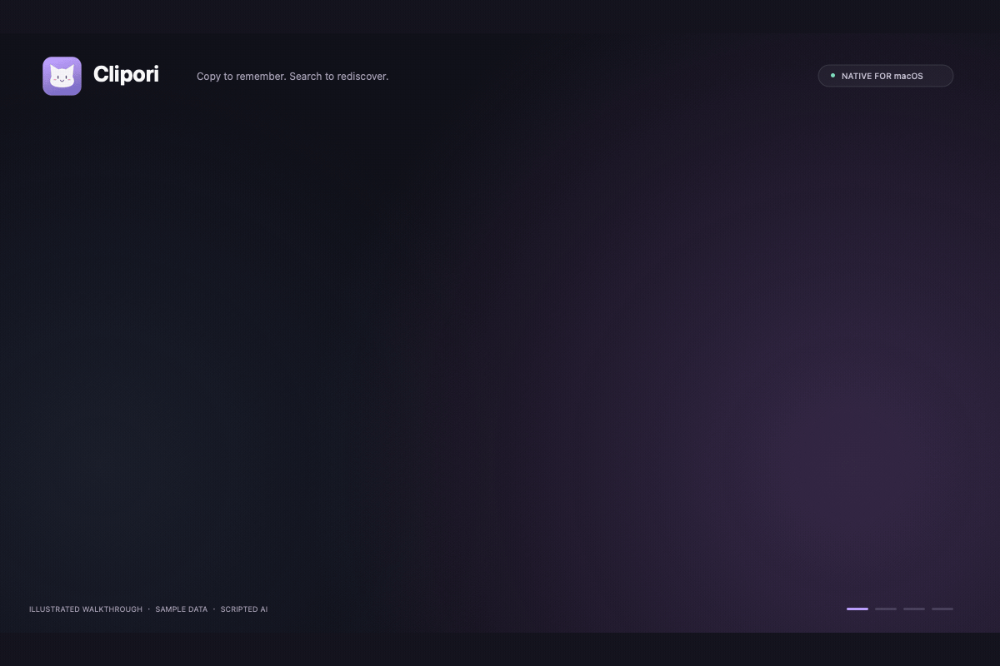

<p align="center">
  
</p>
<h1 align="center">Clipori</h1>
<p align="center"><strong>复制即备忘，想起时就来找回。</strong></p>
<p align="center">一款轻巧、丝滑、可爱的 Mac AI 剪贴板与备忘录。</p>

<p align="center">
  
  
  
  <a href="LICENSE"></a>
</p>
<p align="center">
  <a href="README.md">English</a> · <strong>简体中文</strong><br><br>
  <a href="https://github.com/Panzer-Jack/Clipori/releases"><strong>下载 Mac 版</strong></a> ·
  <a href="#开始使用">开始使用</a> ·
  <a href="docs/USAGE.zh-CN.md">快捷键与操作</a> ·
  <a href="docs/DEVELOPMENT.zh-CN.md">构建与贡献</a>
</p>

## 演示

用底部卡片栏查看复制记录，支持搜索、编辑和分类。

<p align="center">
  
</p>

## 功能

- 自动保存复制的文字、链接、代码、截图和图片。
- `⇧⌘V` 呼出，单击复制，双击粘贴。
- 多选卡片拖入分类，支持固定记录。
- 编辑记录、追加备注，也可以创建桌面便笺。
- AI 搜索与自动分类，支持自定义 OpenAI / Claude 兼容服务。
- 自定义快捷键、语言、保留期限和忽略应用。

## 开始使用

**macOS 14 或更高版本 · 支持 Apple Silicon 与 Intel · 安装包无需 Xcode**

1. **下载应用**：前往 [GitHub Releases](https://github.com/Panzer-Jack/Clipori/releases)，M 系列芯片选择 `arm64`，Intel 选择 `x86_64`。打开 DMG 或解压 ZIP，将 **Clipori.app** 拖入**应用程序**。
2. **首次启动前**，在「终端」执行以下命令，移除应用的隔离标记：

   ```sh
   xattr -dr com.apple.quarantine /Applications/Clipori.app
   ```

3. **唤起卡片栏**：打开 Clipori，按 **`⇧⌘V`**。应用常驻菜单栏，复制文字或图片后便会自动收录。
4. **开启直接粘贴**：在「系统设置 → 隐私与安全性 → 辅助功能」中开启 Clipori。未授权时仍可复制卡片，切回目标应用按 `⌘V` 粘贴。
5. **配置 AI**：在「设置 → AI」选择协议，填写接口地址、模型和 API Key，测试后保存。不配置 AI 也能使用历史记录和关键词搜索。

> 早期构建使用临时签名，尚未通过 Apple 公证。如系统拦截了你信任的安装包，可按 [Apple 官方说明](https://support.apple.com/en-us/102445)使用「仍要打开」。如果 Releases 暂无安装包，可先[从源码构建](docs/DEVELOPMENT.zh-CN.md#从源码构建)。

### 基本操作

| 操作 | 效果 |
| --- | --- |
| `⇧⌘V` | 显示或收起卡片栏 |
| 悬停 | 轻微上浮、高亮，不改变剪贴板 |
| 单击 | 只选中当前卡片，完整替换剪贴板；面板保持打开 |
| 双击 / `↩` | 复制并粘贴到打开面板前的应用 |
| `⌘` 点击 / `⇧` 点击 | 增减选中项 / 连续选择，用于归类 |
| 拖动选中卡片到分类 | 整组归类 |
| 空格 / `⌘E` | 预览 / 编辑与追加 |
| `⌘↩` | 输入问题后让 AI 找回 |

应用快捷键都可以在「设置 → 快捷键」中修改。[查看全部操作 →](docs/USAGE.zh-CN.md)

## 数据与设置

- 历史记录存储在本机 SQLite，API Key 保存在钥匙串。可暂停记录或忽略指定应用，支持常见剪贴板隐私标记。
- AI 搜索向你配置的服务发送问题与候选片段；自动分类发送待分类内容，默认关闭。不会发送图片像素。
- 新安装默认保留 30 天，可选 1 天、1 周、1 个月、1 年或永久。固定记录与 Pinboard 永久保留；升级保留原设置，缩短期限前会确认。
- 系统首选语言为中文时默认中文，其他情况默认英文，也可以在设置中切换。
- 卡片图标自动表示内容类型，颜色跟随所属分类。

<details>
<summary>存储和图片支持的更多细节</summary>

数据库位于 `~/Library/Application Support/Clipori/clipori.sqlite`，可从设置打开目录。忽略规则不能识别所有敏感内容。保留期限从最初保存时间计算，编辑不会延长；删除 Pinboard 不会删除其中的记录，但它们会重新适用普通保留规则。

支持 PNG、TIFF、JPEG。用 `⌃⇧⌘4` 将选区截图复制到剪贴板；仅保存成文件的截图不会自动收录。保留原始像素尺寸与透明度，浏览时使用小缩略图，复制时提供 PNG/TIFF 给支持图片的应用。为图片添加标题和备注后可以搜索。超过 128 MB 或 8000 万像素时会提示，不会保存。

</details>

## 当前进度

| Mac 已支持 | 后续计划 |
| --- | --- |
| 剪贴板历史、截图、编辑、分类、多选拖放、桌面便笺 | iPhone 图片支持与图片同步 |
| AI 找回、可选自动分类 | iCloud 签名配置与跨设备真机联调 |
| 自定义快捷键、中英文、保留规则 | Developer ID 签名、公证与应用内更新 |

仓库也包含 **iPhone 本地客户端**和共享 iCloud 组件。跨设备同步尚未达到日常使用状态，两端默认本地保存；目前没有公开的 iPhone 安装包。多选当前用于归类，暂不支持批量粘贴。

## 构建与贡献

```sh
git clone https://github.com/Panzer-Jack/Clipori.git
cd Clipori
./scripts/build-app.sh
open build/Clipori.app
```

需要 macOS 14+、Xcode 16+。使用 SwiftUI、AppKit 与 SQLite，没有第三方运行时依赖。

- [开发、测试、性能基准与全自动发布](docs/DEVELOPMENT.zh-CN.md)
- [重新生成图标与不含隐私的演示动画](docs/MEDIA.md)
- [反馈问题或提出建议](https://github.com/Panzer-Jack/Clipori/issues)

## 许可

[Apache-2.0](LICENSE)。

灵感来源：[Paste](https://pasteapp.io/)。
